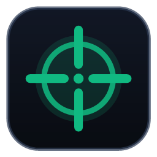

# OpenCrosshair

<p align="center">
  
</p>

<p align="center">
  
  
  
  
</p>

OpenCrosshair is a free, open-source, local-first desktop crosshair overlay and vector customization studio. It provides detailed crosshair controls, local presets, game profiles, and a local streaming endpoint for OBS Studio and Streamlabs. The application is designed to work without accounts, subscriptions, ads, or telemetry.

## Features

### Desktop overlay

- Transparent, click-through, always-on-top overlay window.
- Multi-monitor display selection.
- Windows high-DPI compensation and pixel-aligned positioning.
- Desktop window controls, including minimize, maximize, and close-to-tray behavior.

### Crosshair studio

- Independently adjustable top, bottom, left, and right arms.
- T-shape mode, arm gap, thickness, outline, color, and corner rounding.
- Square or circular center dot with configurable radius and outline.
- Tactical rings, segmented patterns, and chevrons.
- Shadow and glow controls.
- Recoil bloom simulation and aim-down-sights zoom settings.

### Presets and game profiles

- Save, organize, and duplicate crosshair presets locally.
- Share crosshair settings with `OC-XXXXX` share codes.
- Associate supported game executables with preferred crosshairs and switch profiles when the game becomes active.
- Includes example presets for games such as Counter-Strike 2, Valorant, Apex Legends, Rust, and Overwatch 2.

### Streaming integration

- Local HTTP and WebSocket server for streaming overlays.
- Configurable server port with fallback scanning when the default port is occupied.
- Browser-source integration for OBS Studio and Streamlabs.

### Interface and privacy

- Light and dark themes.
- Multiple interface font-size settings.
- Local-first operation with no account requirement or telemetry, as described by the project.

OpenCrosshair is designed to render an external overlay without injecting code into game processes or modifying game memory. Anti-cheat policies vary by game and may change, so compatibility cannot be guaranteed for every title or anti-cheat system.

## Downloads

The current release described by this README is **v1.4.0**. Check the release notes and package details before installing.

| Platform | Package | Download |
| --- | --- | --- |
| Windows x64 | Installer | [OpenCrosshair Setup 1.4.0.exe](https://github.com/mtcxdev/open-crosshair/releases/download/v1.4.0/OpenCrosshair.Setup.1.4.0.exe) |
| Windows x64 | Portable executable | [OpenCrosshair 1.4.0.exe](https://github.com/mtcxdev/open-crosshair/releases/download/v1.4.0/OpenCrosshair.1.4.0.exe) |
| Linux | AppImage | [OpenCrosshair-1.4.0.AppImage](https://github.com/mtcxdev/open-crosshair/releases/download/v1.4.0/OpenCrosshair-1.4.0.AppImage) |
| Linux | Debian package | [open-crosshair_1.4.0_amd64.deb](https://github.com/mtcxdev/open-crosshair/releases/download/v1.4.0/open-crosshair_1.4.0_amd64.deb) |
| macOS | DMG | [OpenCrosshair-1.4.0-arm64.dmg](https://github.com/mtcxdev/open-crosshair/releases/download/v1.4.0/OpenCrosshair-1.4.0-arm64.dmg) |

- [Release notes and checksums](releases/v1.4.0/README.md)
- [All release documentation](releases/README.md)
- [GitHub releases](https://github.com/mtcxdev/open-crosshair/releases)

## Global shortcuts

| Shortcut | Action |
| --- | --- |
| `Ctrl + Shift + X` | Show or hide the overlay |
| `Ctrl + Shift + C` | Re-center the overlay on the primary display |

## Add OpenCrosshair to OBS Studio or Streamlabs

1. Open OBS Studio or Streamlabs and add a **Browser Source**.
2. Name the source `Crosshair Overlay`.
3. Set the URL to `http://localhost:3175` (or the port configured in the application).
4. Set the width and height to match the stream canvas, such as `1920 x 1080`.
5. Save the source. The overlay should render against a transparent background.

If the configured port changes, use the active port shown by the application.

## Build from source

### Prerequisites

- Node.js 18 or later
- npm 9 or later

### Install and run

```bash
git clone https://github.com/mtcxdev/open-crosshair.git
cd open-crosshair
npm install
npm run dev
```

Start the packaged application with:

```bash
npm start
```

### Build distributables

```bash
# Build installer and portable Windows packages
npm run dist

# Build the portable Windows package
npm run dist:portable

# Run the project's multi-platform packaging command
npm run dist:all
```

Availability of platform-specific builds depends on the build environment and the project's packaging configuration.

## Support the project

OpenCrosshair is intended to remain free to use. If you find it useful, you can support continued development:

- [GitHub Sponsors](https://github.com/sponsors/mtcxdev)
- [Buy Me a Coffee](https://buymeacoffee.com/mtcxdev)

The application also lists optional cryptocurrency donation addresses. Verify addresses inside the application before sending funds.

## Contributing

Issues, bug reports, and focused pull requests are welcome. When reporting a problem, include the application version, operating system, steps to reproduce, and relevant logs without sharing private information.

## License

OpenCrosshair is distributed under the [MIT License](LICENSE).
